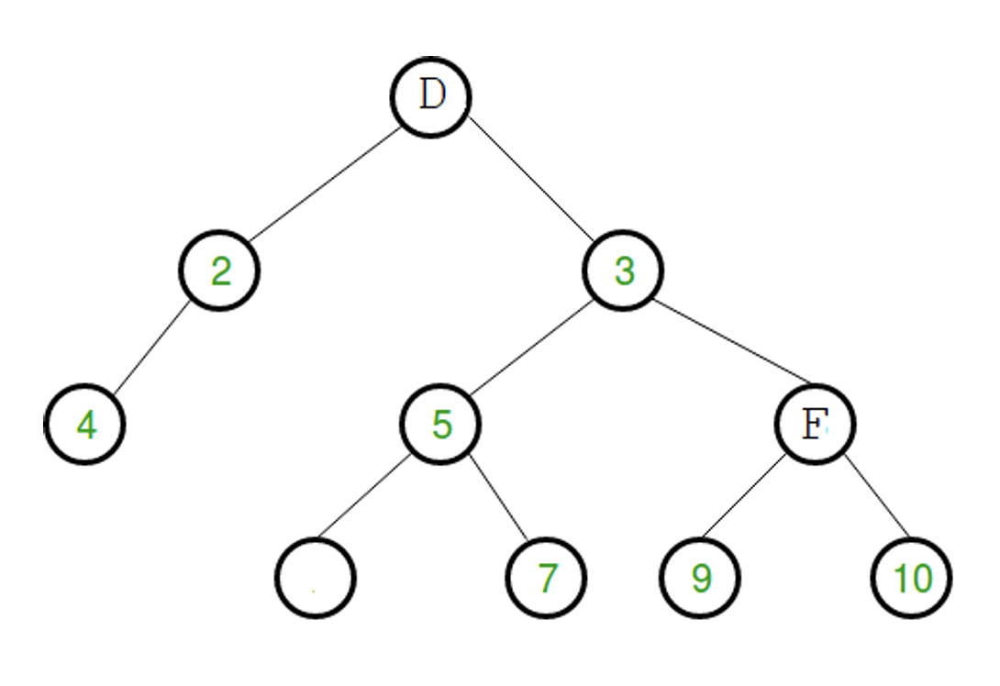
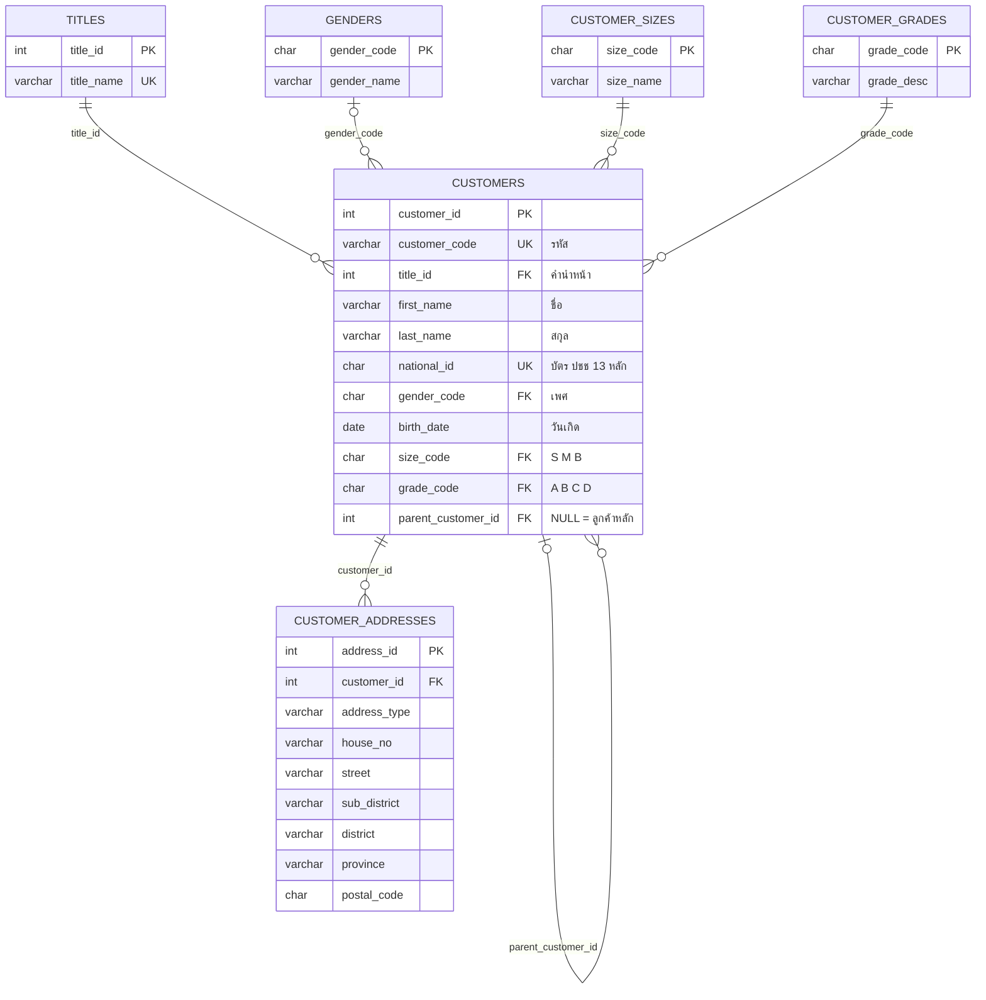

**Software Engineer Assessment Test — คำตอบ** · บริษัท เซาท์แลนด์รับเบอร์ จำกัด

ผู้ทำ: Phurich Nilvisut · ภาษาที่ใช้: TypeScript และ SQL (SQLite)

Source code: [github.com/phurich-n/se-test](https://github.com/phurich-n/se-test)

หน้าเว็บ interactive (กด Run ดูการทำงานทีละขั้นได้ทุกข้อ): [phurich-n.github.io/se-test](https://phurich-n.github.io/se-test/)

---

##### 1. หากพบว่าโปรแกรมและเว็บไซต์ที่พัฒนาขึ้นมา ใช้งานแล้วมีปัญหาใช้งานไม่ได้ เราจะตรวจสอบปัญหาเบื้องต้นยังไง จงอธิบาย

**คำตอบ**

เริ่มจากฝั่งผู้ใช้ก่อน แล้วค่อยๆ ไล่เข้าไปหาเซิร์ฟเวอร์ ดูภาพรวมก่อนแล้วค่อยเจาะทีละจุด

1. **ลองทำให้เจอปัญหาเองก่อน** — ถามให้ชัดว่าใครเจอ เจอกี่คน เจอหน้าไหน กดอะไรแล้วพัง ขึ้น error ว่าอะไร เริ่มเป็นตั้งแต่เมื่อไหร่ แล้วเป็นทุกเครื่องหรือบางเครื่อง
2. **เช็กว่าช่วงนี้มีอะไรเปลี่ยนไปบ้าง** — ปัญหาส่วนใหญ่มาจากของที่เพิ่งเปลี่ยน เช่น เพิ่ง deploy เวอร์ชันใหม่ แก้ config อัปเดต library หรือ SSL กับโดเมนหมดอายุ ถ้าเจอว่าเพิ่ง deploy แล้วพังทันที ให้ rollback กลับไปก่อน ระบบจะได้กลับมาใช้ได้
3. **ดูที่ฝั่งผู้ใช้ (browser)** — กด F12 เปิด devtools แท็บ console ดูว่ามี javascript error ไหม แท็บ Network ดูว่า request ไหนได้ 4xx หรือ 5xx ลองล้าง cache หรือเปิดด้วย browser อื่นดู
4. **ดูเรื่องเน็ตและการเชื่อมต่อ** — ping ถึงเซิร์ฟเวอร์ไหม ชื่อโดเมนชี้ถูกที่หรือเปล่า (`nslookup`) SSL ยังไม่หมดอายุใช่ไหม firewall หรือ port ถูกปิดอยู่หรือเปล่า
5. **ดูที่เซิร์ฟเวอร์และตัวแอป** — service ยังรันอยู่ไหม เปิด log ของแอปกับ web server ดูว่ามี error อะไร แล้วเช็กว่า CPU, RAM หรือ disk เต็มหรือเปล่า
6. **ดูฐานข้อมูลและระบบอื่นที่แอปต้องพึ่ง** — ต่อ database ได้ไหม connection เต็มหรือยัง มี query ที่ช้าหรือติด lock ไหม แล้ว API ภายนอกที่เรียกใช้ล่มอยู่หรือเปล่า
7. **แก้ให้ตรงจุด แล้วกันไม่ให้เกิดซ้ำ** — หาสาเหตุจริงให้เจอ (root cause) ไม่ใช่แค่อาการ แก้แล้วลองซ้ำให้แน่ใจว่าหาย แจ้งผู้ใช้ว่ากลับมาใช้ได้แล้ว แล้วเพิ่ม monitoring หรือ test เพื่อให้รู้ตัวก่อนถ้าเกิดอีก

---

##### 2. จากส่วนของโปรแกรมที่กำหนดให้ต่อไปนี้ หลังจากจบการทำงานแล้ว ค่าของ i มีค่าเป็นเท่าใด

```text
x := 1;
i := 1;
while (x <= 1000)
begin
  x := 2^x;
  i := i + 1;
end;
```

เขียนโปรแกรมหรือ Pseudocode และ run คำสั่งพร้อมผลลัพธ์

**คำตอบ: i = 5**

โปรแกรม (TypeScript — [`src/q2.ts`](https://github.com/phurich-n/se-test/blob/HEAD/src/q2.ts))

```ts
let x = 1;
let i = 1;

while (x <= 1000) {
  x = 2 ** x; // ** คือยกกำลัง (ใน JavaScript ^ คือ XOR)
  i = i + 1;
}

console.log(`i = ${i}`);
```

ผลลัพธ์

```text
i = 5
```

ทำงานทีละรอบ

| รอบ | x ก่อน | x = 2^x | i | x ≤ 1000 ? |
|:---:|---:|---:|:---:|---|
| 1 | 1 | 2 | 2 | วนต่อ |
| 2 | 2 | 4 | 3 | วนต่อ |
| 3 | 4 | 16 | 4 | วนต่อ |
| 4 | 16 | 65,536 | 5 | หยุด |

x โตแบบ 2 ยกกำลังซ้อนกัน (1 → 2 → 4 → 16 → 65,536) พอถึงรอบที่ 4 ค่า x เกิน 1000 จึงออกจาก loop ได้ **i = 5**

---

##### 3. ถ้า n มีค่าเท่ากับ 256 หลังจากจบการทำงานแล้ว r มีค่าเป็นเท่าใด

```text
1  i := n;
2  r := 0;
3  while (i >= 1) do
4  begin
5    for j:=1 to n do
6      r := r+1;
7    i := i/2;
8  end;
```

เขียนโปรแกรมหรือ Pseudocode และ run คำสั่งพร้อมผลลัพธ์

**คำตอบ: r = 2,304**

โปรแกรม (TypeScript — [`src/q3.ts`](https://github.com/phurich-n/se-test/blob/HEAD/src/q3.ts))

```ts
function run(n: number): number {
  let i = n;
  let r = 0;

  while (i >= 1) {
    for (let j = 1; j <= n; j++) {
      r = r + 1; // loop ข้างในทำ n ครั้งเสมอ
    }
    i = i / 2;
  }
  return r;
}

const n = 256;
const r = run(n);

console.log(`r = ${r}`);
console.log(`check ด้วยสูตร: n * (log2(n) + 1) = ${n} * ${Math.log2(n) + 1} = ${n * (Math.log2(n) + 1)}`);
```

ผลลัพธ์

```text
r = 2304
check ด้วยสูตร: n * (log2(n) + 1) = 256 * 9 = 2304
```

อธิบาย

- loop ข้างใน (`for j := 1 to n`) บวก r ทีละ 1 จำนวน n ครั้ง แต่ละรอบ r จึงเพิ่มขึ้น 256
- loop ข้างนอกหาร i ครึ่งทุกรอบ: 256, 128, 64, 32, 16, 8, 4, 2, 1 รวม **9 รอบ** (= ⌊log₂256⌋ + 1)
- r = 256 × 9 = **2,304**
- Time complexity เป็น **O(n log n)**

---

##### 4. ให้เขียนภาษาโปรแกรมอะไรก็ได้หรือ Pseudocode หาผลรวมของตัวเลขใน Tree นี้



**คำตอบ: 40**

บาง node เป็นตัวอักษร (D, F) และมี node ว่าง 1 ตัว จึงต้องบวกเฉพาะค่าที่เป็นตัวเลข

2 + 3 + 4 + 5 + 7 + 9 + 10 = **40**

โปรแกรม (TypeScript — [`src/q4.ts`](https://github.com/phurich-n/se-test/blob/HEAD/src/q4.ts))

```ts
type NodeValue = number | string | null; // ตัวเลข, ตัวอักษร หรือ node ว่าง

interface TreeNode {
  value: NodeValue;
  left?: TreeNode;
  right?: TreeNode;
}

const node = (value: NodeValue, left?: TreeNode, right?: TreeNode): TreeNode => ({ value, left, right });

const root: TreeNode = node(
  "D",
  node(2, node(4)),
  node(3, node(5, node(null), node(7)), node("F", node(9), node(10))),
);

// วิธีที่ 1: Recursion (DFS) — ผลรวม = ค่าของตัวเอง + ผลรวมซ้าย + ผลรวมขวา
function sumRecursive(n?: TreeNode): number {
  if (!n) return 0;
  const own = typeof n.value === "number" ? n.value : 0; // ข้าม D, F และ node ว่าง
  return own + sumRecursive(n.left) + sumRecursive(n.right);
}

// วิธีที่ 2: Queue (BFS) — ไล่ทีละชั้น ไม่ใช้ recursion
function sumIterative(start: TreeNode): number {
  let total = 0;
  const queue: TreeNode[] = [start];
  let head = 0; // ชี้หัวคิว แทน queue.shift() ที่ต้องเลื่อนสมาชิกทุกตัว (O(n) ต่อครั้ง)
  while (head < queue.length) {
    const current = queue[head++];
    if (typeof current.value === "number") total += current.value;
    if (current.left) queue.push(current.left);
    if (current.right) queue.push(current.right);
  }
  return total;
}

console.log("ผลรวม (Recursive DFS):", sumRecursive(root));
console.log("ผลรวม (Iterative BFS):", sumIterative(root));
```

ผลลัพธ์

```text
ผลรวม (Recursive DFS): 40
ลำดับการเยี่ยม (BFS): D -> 2 -> 3 -> 4 -> 5 -> F -> (ว่าง) -> 7 -> 9 -> 10
ผลรวม (Iterative BFS): 40
```

| | Recursion (DFS) | Queue (BFS) |
|---|---|---|
| Time | O(n) | O(n) |
| Space | O(h) — ความสูงของ tree | O(w) — ความกว้างของชั้นที่กว้างที่สุด |
| ข้อดี | โค้ดสั้น อ่านแล้วเข้าใจทันที | ไม่เสี่ยง stack overflow |

---

##### 5. ให้ทำการ Design และ Normalization Database Table ข้อมูลลูกค้า โดยประกอบไปด้วย ***รหัส, คำนำหน้า, ชื่อ, สกุล, ที่อยู่, บัตร ปชช, เพศ, วันเกิด, ขนาดลูกค้า (S,M,B), เกรดลูกค้า (A,B,C,D)*** โดยลูกค้าบางรายอาจจะ***เป็นลูกค้าย่อยของลูกค้าหลักได้*** (เขียนเป็น ER Diagram)

**คำตอบ: 6 ตาราง**

ER Diagram



ตารางทั้งหมด

| ตาราง | เก็บอะไร | ความสัมพันธ์กับ customers |
|---|---|---|
| `customers` | ข้อมูลลูกค้า (รหัส ชื่อ สกุล บัตร ปชช วันเกิด) | — |
| `titles` | คำนำหน้า (นาย, นาง, นางสาว, บริษัท) | 1 : N |
| `genders` | เพศ (M, F, U) | 1 : N |
| `customer_sizes` | ขนาดลูกค้า (S, M, B) | 1 : N |
| `customer_grades` | เกรดลูกค้า (A, B, C, D) | 1 : N |
| `customer_addresses` | ที่อยู่ แยกเป็นช่องย่อย | ลูกค้า 1 ราย มีได้หลายที่อยู่ (1 : N) |

เหตุผลการ Normalize

- **1NF** — ทุกช่องเก็บค่าเดียว แยก "ที่อยู่" เป็นบ้านเลขที่ / ถนน / ตำบล / อำเภอ / จังหวัด / รหัสไปรษณีย์ และแยกเป็นตาราง `customer_addresses` เพราะลูกค้า 1 รายมีได้หลายที่อยู่ ไม่ต้องมีคอลัมน์ address1, address2 ซ้ำๆ
- **2NF** — ทุกตารางใช้ primary key คอลัมน์เดียว ทุกคอลัมน์จึงขึ้นกับ key ทั้งหมด ไม่มี partial dependency
- **3NF** — คำนำหน้า เพศ ขนาด และเกรด แยกเป็น lookup table ไม่เก็บคำอธิบายซ้ำทุกแถวลูกค้า (ไม่มี transitive dependency) และแก้ได้ในที่เดียว
- **ลูกค้าหลัก–ลูกค้าย่อย** — ใช้ self-referencing foreign key `parent_customer_id` ชี้กลับไปที่ `customers.customer_id` ของตารางเดียวกัน ถ้าเป็น NULL คือลูกค้าหลัก ลูกค้าหลัก 1 รายมีลูกค้าย่อยได้หลายราย (1 : N) มี CHECK กันไม่ให้ลูกค้าเป็น parent ของตัวเอง และมี trigger กันวงวนหลายชั้น (เช่น A เป็นลูกของ B และ B เป็นลูกของ A) เพราะถ้าเกิดวงจะไม่มีลูกค้าหลัก และ query ที่ไล่ลำดับชั้นจะวนไม่จบ
- `customer_code` และ `national_id` เป็น UNIQUE และใช้ `customer_id` เป็น surrogate key เพื่อให้เปลี่ยนรหัสทางธุรกิจได้โดยไม่กระทบ foreign key
- `national_id` เป็นข้อมูลส่วนบุคคลตาม PDPA ควรเข้ารหัสและจำกัดสิทธิ์การเข้าถึง

SQL สร้างตาราง ([`sql/q5_schema.sql`](https://github.com/phurich-n/se-test/blob/HEAD/sql/q5_schema.sql))

```sql
CREATE TABLE titles (                 -- คำนำหน้า
  title_id    INTEGER PRIMARY KEY,
  title_name  VARCHAR(30) NOT NULL UNIQUE   -- นาย, นาง, นางสาว, บริษัท ...
);

CREATE TABLE genders (                -- เพศ
  gender_code CHAR(1) PRIMARY KEY,          -- M, F, U
  gender_name VARCHAR(20) NOT NULL
);

CREATE TABLE customer_sizes (         -- ขนาดลูกค้า
  size_code   CHAR(1) PRIMARY KEY,          -- S, M, B
  size_name   VARCHAR(20) NOT NULL
);

CREATE TABLE customer_grades (        -- เกรดลูกค้า
  grade_code  CHAR(1) PRIMARY KEY,          -- A, B, C, D
  grade_desc  VARCHAR(50) NOT NULL
);

CREATE TABLE customers (
  customer_id        INTEGER PRIMARY KEY,
  customer_code      VARCHAR(20) NOT NULL UNIQUE,   -- รหัสลูกค้า (รหัสทางธุรกิจ)
  title_id           INTEGER NOT NULL REFERENCES titles(title_id),
  first_name         VARCHAR(100) NOT NULL,
  last_name          VARCHAR(100),
  national_id        CHAR(13) UNIQUE,               -- บัตรประชาชน 13 หลัก
  gender_code        CHAR(1) REFERENCES genders(gender_code),
  birth_date         DATE,
  size_code          CHAR(1) NOT NULL REFERENCES customer_sizes(size_code),
  grade_code         CHAR(1) NOT NULL REFERENCES customer_grades(grade_code),
  parent_customer_id INTEGER NULL REFERENCES customers(customer_id),  -- NULL = ลูกค้าหลัก
  CHECK (parent_customer_id IS NULL OR parent_customer_id <> customer_id)
);

CREATE TABLE customer_addresses (     -- ที่อยู่ (1 ลูกค้ามีได้หลายที่อยู่)
  address_id    INTEGER PRIMARY KEY,
  customer_id   INTEGER NOT NULL REFERENCES customers(customer_id),
  address_type  VARCHAR(20) NOT NULL DEFAULT 'HOME',  -- HOME, BILLING, SHIPPING
  house_no      VARCHAR(50),
  street        VARCHAR(100),
  sub_district  VARCHAR(100),
  district      VARCHAR(100),
  province      VARCHAR(100),
  postal_code   CHAR(5)
);

CREATE INDEX idx_customers_parent ON customers(parent_customer_id);

-- กันวงวนของลูกค้าหลัก–ลูกค้าย่อย (เช่น A เป็นลูกของ B และ B เป็นลูกของ A)
-- CHECK ด้านบนกันได้แค่ A → A จึงใช้ trigger ไล่ขึ้นไปตาม parent ทีละชั้น
-- ถ้าเจอตัวเองระหว่างทาง แปลว่าจะเกิดวง ให้ยกเลิกการแก้ไข
-- (ตอน INSERT เกิดวงไม่ได้ เพราะยังไม่มีแถวไหนชี้มาที่ลูกค้าใหม่)
CREATE TRIGGER trg_customers_no_parent_cycle
BEFORE UPDATE OF parent_customer_id ON customers
WHEN NEW.parent_customer_id IS NOT NULL
BEGIN
  SELECT RAISE(ABORT, 'parent_customer_id ทำให้เกิดวงวนของลูกค้าหลัก–ลูกค้าย่อย')
  WHERE EXISTS (
    WITH RECURSIVE ancestors(id) AS (
      SELECT NEW.parent_customer_id
      UNION
      SELECT c.parent_customer_id
      FROM customers c JOIN ancestors a ON c.customer_id = a.id
      WHERE c.parent_customer_id IS NOT NULL
    )
    SELECT 1 FROM ancestors WHERE id = NEW.customer_id
  );
END;
```

ไฟล์ฐานข้อมูลจริง: [`db/customers.db`](https://github.com/phurich-n/se-test/blob/HEAD/db/customers.db) (SQLite)

---

##### 6. จากข้อที่ 5 ให้ทำการค้นหาข้อมูลลูกค้าย่อยเท่านั้นและให้แสดงว่าเป็นลูกค้าย่อยของลูกค้าหลักรายไหน (เขียน Query)

**คำตอบ: ใช้ SELF JOIN**

Query ([`sql/q6_query.sql`](https://github.com/phurich-n/se-test/blob/HEAD/sql/q6_query.sql))

```sql
SELECT
  c.customer_code                                AS sub_customer_code,
  t1.title_name || c.first_name || ' ' || COALESCE(c.last_name, '') AS sub_customer_name,
  p.customer_code                                AS main_customer_code,
  t2.title_name || p.first_name || ' ' || COALESCE(p.last_name, '') AS main_customer_name
FROM customers c
INNER JOIN customers p ON c.parent_customer_id = p.customer_id
INNER JOIN titles t1   ON c.title_id = t1.title_id
INNER JOIN titles t2   ON p.title_id = t2.title_id
ORDER BY p.customer_code, c.customer_code;
```

ผลลัพธ์จากข้อมูลตัวอย่าง

| sub_customer_code | sub_customer_name | main_customer_code | main_customer_name |
|---|---|---|---|
| C003 | นางสาวสมหญิง รักงาน | C001 | บริษัท ยางไทย จำกัด |
| C004 | นายประเสริฐ มั่นคง | C001 | บริษัท ยางไทย จำกัด |
| C005 | นางมาลี สุขใจ | C002 | นายสมชาย ใจดี |

อธิบาย

- เปิดตาราง `customers` สองชุดพร้อมกัน `c` คือลูกค้าย่อย `p` คือลูกค้าหลัก แล้วจับคู่ด้วย `c.parent_customer_id = p.customer_id`
- ใช้ `INNER JOIN` ลูกค้าหลักที่ `parent_customer_id` เป็น NULL จึงไม่มีคู่และไม่แสดง เหลือเฉพาะลูกค้าย่อยตามที่โจทย์ต้องการ
- join ตาราง `titles` สองรอบ (`t1`, `t2`) เพื่อแสดงคำนำหน้าของทั้งลูกค้าย่อยและลูกค้าหลัก
- `COALESCE(last_name, '')` กันกรณีไม่มีนามสกุล (เช่นนิติบุคคล) ไม่ให้ชื่อทั้งก้อนกลายเป็น NULL
- มี index `idx_customers_parent` บน `parent_customer_id` การ join จึงเร็วแม้ข้อมูลเยอะ
